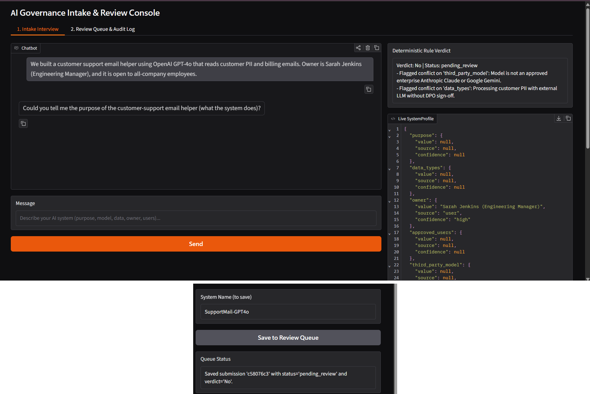
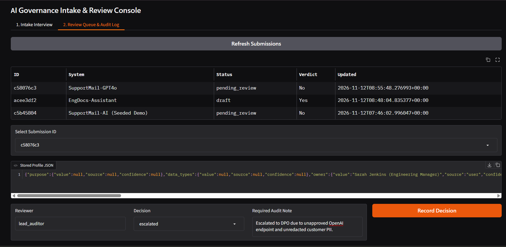
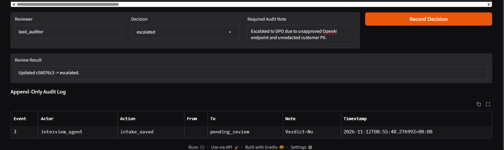

# AI Governance Interview Agent

An AI intake and compliance triage system that interviews engineering teams about new AI systems, cross-checks claims against company policy, flags contradictions for human review instead of guessing, and enforces an append-only SQLite audit log.

> Separates conversational LLM extraction (LangGraph + Pydantic) from deterministic compliance verdicts (plain Python rules) and trigger-enforced human sign-off (SQLite + Gradio).

[](https://python.org)
[](https://langchain-ai.github.io/langgraph/)
[](https://docs.pydantic.dev/)
[](https://sqlite.org)
[](https://gradio.app)
[]()

---

## Why This Project?

LLMs are useful for interviewing engineers and turning messy descriptions into structured metadata, but unreliable as final compliance judges—they are non-deterministic, vulnerable to prompt injection, and hard to audit.

This project enforces a strict boundary:
- **The LLM interviews and flags**: collects 5 required fields with provenance (`value`, `source`, `confidence`) and flags policy clashes via `flag_conflict`.
- **Plain Python decides**: a zero-LLM rule engine outputs deterministic `Yes`, `No`, or `Unknown` verdicts.
- **Humans approve or escalate**: flagged items enter a guarded review queue (`draft -> pending_review -> approved / escalated`) backed by an append-only audit log.

---

## Screenshots

### 1. Intake Interview & Live Conflict Detection
The agent interviews the user, extracts structured field provenance (`value`, `source`, `confidence`) into `Live SystemProfile`, and flags policy violations (`OpenAI GPT-4o` and `customer PII`)—setting `Verdict: No` and saving the submission (`c58076c3`) as `pending_review`.



### 2. Human Review Queue & Stored Profile Inspection
In the Review Queue tab, a compliance reviewer (`lead_auditor`) inspects all queued submissions (`pending_review` vs. `draft`), loads the stored JSON profile for `c58076c3`, and enters a mandatory audit note to escalate the system.



### 3. Decision Recording & Append-Only Audit Log
Recording the review transitions `c58076c3` to `escalated` and appends a tamper-protected entry to the `Append-Only Audit Log` (`actor`, `action`, `from -> to` status, `note`, and UTC timestamp).



---

## Architecture

```text
                       ┌──────────────────────────┐
                       │        Gradio UI         │  Intake Chat · Review Queue · Audit Log
                       └────────────┬─────────────┘
                                    │
                  ┌─────────────────┴─────────────────┐
                  ▼                                   ▼
   ┌─────────────────────────────┐     ┌─────────────────────────────┐
   │    LangGraph Agent Loop     │     │   Deterministic Rule Engine │
   │    interview <-> tools      │     │   evaluate_profile()        │
   └──────────────┬──────────────┘     │   Yes / No / Unknown        │
                  │                    └──────────────┬──────────────┘
      ┌───────────┼───────────┐                       │
      ▼           ▼           ▼                       │
lookup_doc   update_prof  flag_conflict               │
      │           │           │                       │
      └───────────┴───────────┴───────────┬───────────┘
                                          ▼
                          ┌───────────────────────────────┐
                          │   SQLite Governance Store     │
                          │   submissions + audit_log     │
                          │   (BEFORE UPDATE/DELETE block)│
                          └───────────────────────────────┘

```

**LLM Fallback Chain:** `Groq (openai/gpt-oss-120b)` -> `Groq (openai/gpt-oss-20b)` -> `Groq (qwen/qwen3.8-27b)` -> `Google Gemini (gemini-3-flash-preview)` with bound tools across all models.

---

## Key Engineering Decisions

**1. Per-field provenance (`TrackedField[T]`) instead of flat strings.**
Every profile field (`purpose`, `data_types`, `owner`, `approved_users`, `third_party_model`) wraps `value`, `source`, and discrete `confidence` (`high`, `medium`, `low`). Missing fields stay `None` rather than being guessed.

**2. Custom state reducer (`merge_profile`) for parallel tool calls.**
When the LLM batches multiple `update_profile` and `flag_conflict` calls in a single turn, LangGraph runs them concurrently in one step. A custom reducer merges non-null fields, deduplicates conflicts, and promotes status to `pending_review` without state collision errors.

**3. Deterministic Python rules (`app/rules.py`) over LLM-as-a-Judge.**
Even if the agent misses a conflict flag, `evaluate_profile()` independently checks approved models, restricted data keywords (PII, payment, medical), and access scope, rejecting violations (`No`) before checking completeness (`Unknown` vs. `Yes`).

**4. Storage-level immutability on `audit_log`.**
SQLite `BEFORE UPDATE` and `BEFORE DELETE` triggers (`RAISE(ABORT, ...)`) block history tampering directly inside the database engine, paired with state-transition guards and mandatory reviewer notes in `app/store.py`.

---

## Evaluation & Testing

Benchmarked against 5 realistic intake scenarios (`evals/cases.json`)—3 containing planted policy violations and 2 compliant baselines:

| Case ID | Scenario | Expected Verdict | Actual Verdict | Expected Flags | Actual Flags | Result |
| --- | --- | --- | --- | --- | --- | --- |
| `clean_internal_rag` | Gemini 2.5 Flash on public docs | `Yes` | `Yes` | `[]` | `[]` | Pass |
| `clean_claude_triage` | Enterprise Claude on anonymized logs | `Yes` | `Yes` | `[]` | `[]` | Pass |
| `conflict_unapproved_model` | OpenAI GPT-4o on repo diffs | `No` | `No` | `['third_party_model']` | `['third_party_model']` | Pass |
| `conflict_pii_and_broad_access` | Customer PII + `all-company` access | `No` | `No` | `['approved_users', 'data_types']` | `['approved_users', 'data_types']` | Pass |
| `conflict_medical_data` | Employee medical records | `No` | `No` | `['data_types']` | `['data_types']` | Pass |

5 hand-written cases, so this shows the pipeline works, not that it generalizes.

**Summary Metrics:**

* **Conflict detection rate (recall):** `3/3 (100.0%)`
* **False-flag rate:** `0/2 (0.0%)`
* **Offline unit tests (`pytest`):** `2 passed` (rule verdict edge cases, state transition guards, and SQLite append-only triggers)

---

## Project Structure

```text
gov-interview-agent/
├── app/
│   ├── schemas.py        # TrackedField[T], ConflictFlag, SystemProfile
│   ├── llm.py            # Multi-model Groq -> Gemini fallback with bound tools
│   ├── tools.py          # lookup_document, update_profile, flag_conflict
│   ├── agent.py          # LangGraph StateGraph + merge_profile reducer
│   ├── rules.py          # Deterministic Yes / No / Unknown evaluator
│   ├── store.py          # SQLite review queue + trigger-enforced audit_log
│   └── ui.py             # Gradio intake & human review console
├── data/
│   └── sample_policy.md  # Company AI governance policy
├── evals/
│   ├── cases.json        # Planted conflict + clean baseline cases
│   └── run_eval.py       # Catch-rate and false-flag benchmark runner
├── tests/
│   └── test_governance.py
├── intake-interview.png
├── review&audit1.png
├── review&audit2.png
└── requirements.txt

```

---

## Run Locally

```bash
git clone [https://github.com/Riyasharma-17/gov-interview-agent](https://github.com/Riyasharma-17/gov-interview-agent)
cd gov-interview-agent
pip install -r requirements.txt
```

Create a `.env` file in the root directory:

```env
GROQ_API_KEY=your_groq_key
GEMINI_API_KEY=your_gemini_key
```

```bash
# Offline unit tests
pytest

# Live conflict-detection benchmark
python -m evals.run_eval

# Launch Gradio console
python -m app.ui
# opens at [http://127.0.0.1:7860](http://127.0.0.1:7860)
```

---

## What This Is and What It Is Not

**What this is:**

* A clean, auditable reference architecture demonstrating human-in-the-loop AI governance with deterministic policy enforcement.

**What this is not:**

* Not a large-corpus RAG engine: `lookup_document` uses section-level keyword overlap suited for a concise policy document rather than vector embeddings.
* Not backed by persistent cloud storage on free hosting: Render's free web service uses an ephemeral disk, so `data/governance.db` resets on container sleep/redeploy (seeding one demo submission on startup).
* Not tamper-proof against OS root access: local SQLite triggers prevent SQL mutations, whereas production compliance logs would add cryptographic hash chaining or external WORM storage.

---

## What I Learned

* **Where LLMs belong in compliance:** LLMs excel at structured extraction during interviews, but final compliance decisions must stay in deterministic Python rules for reproducibility and auditability.
* **Parallel tool execution in LangGraph:** Batching multiple tool calls in a single step requires a custom state reducer (`merge_profile`) and strict tool parameter types (`str | list[str]` rather than `Any`) so JSON schemas validate cleanly across providers.
* **Free-tier quota engineering:** Per-minute token limits on reasoning models require compact prompts, low reasoning effort, and multi-model fallback chains with identical bound tool schemas.
* **Database-enforced invariants:** Putting `BEFORE UPDATE/DELETE` triggers and state-transition checks in SQLite guarantees audit integrity regardless of which UI or script writes to the store.


